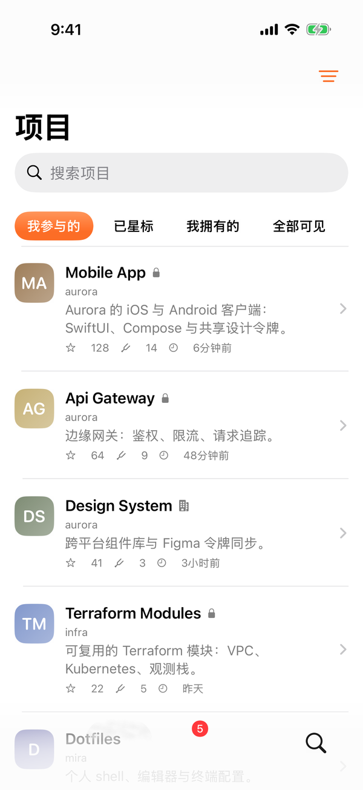
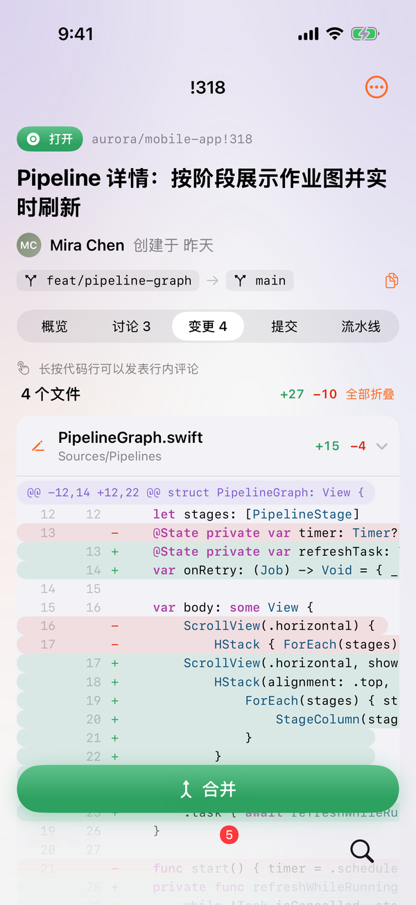
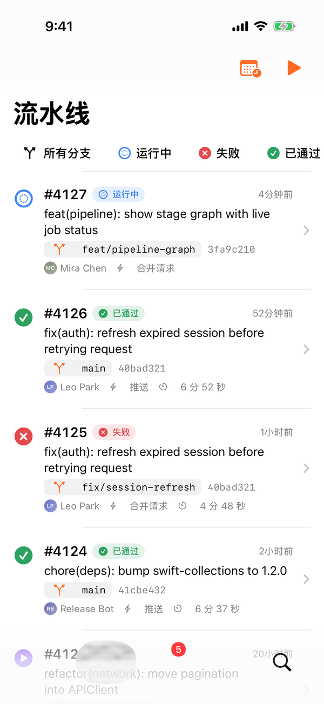
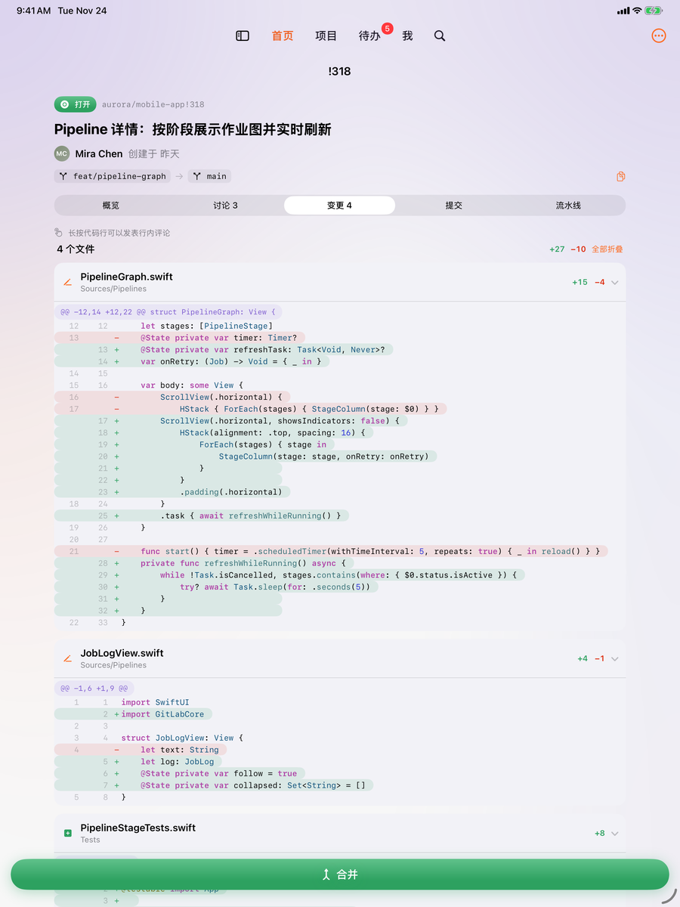
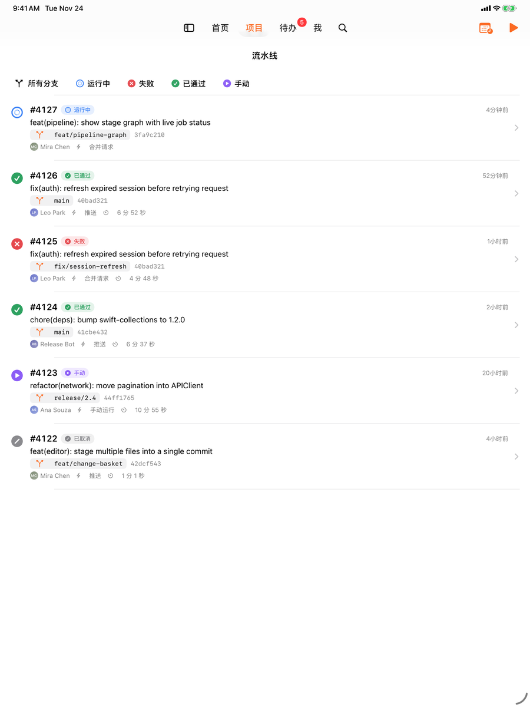

# Gitlabio

gitlab.com 与自建 GitLab 的原生移动客户端。iOS 用 SwiftUI，在 iOS 26 上使用 Liquid Glass，iOS 18–25 自动回退为材质效果。Android 用 Kotlin + Jetpack Compose（Material 3）。

> 状态：iOS 0.2（M2）界面与功能已重写，经 CI 构建和截图测试；Android 仍是 M1 早期版本，重写在进行中。

## 截图

<p>
  
  
  
</p>
<p>
  
  
</p>

项目列表与筛选、合并请求的逐文件差异、按状态筛选的流水线列表（iPhone 与 iPad）。

App Store：[MyCodeio](https://apps.apple.com/app/id6827831053)

## iOS 功能

| 领域 | 已实现 |
| --- | --- |
| 账户 | 个人访问令牌登录，检测令牌范围（只读令牌会提示）；多个账户和实例切换；令牌存于钥匙串（仅本设备） |
| 自建实例 | 支持部署子路径；证书不受信任时显示证书链和 SHA-256 指纹，可固定服务器证书或导入组织 CA；不提供忽略证书错误的选项 |
| 首页 | 待我审查、指派给我的 MR 和 Issue、待办数、最近动态 |
| 项目 | 搜索；按参与 / 星标 / 拥有 / 全部筛选和排序；项目概览含 README 渲染、最新流水线、克隆地址；星标 |
| 代码 | 分支 / 标签切换、面包屑、语法高亮与行号、Markdown 渲染、图片预览、文件历史 |
| 编辑与提交 | 编辑、新建、删除文件，先放进“变更篮”，再通过 Commits API 一次提交多个文件；可提交到新分支并同时创建 MR |
| 提交与分支 | 提交历史（按日期分组）、提交详情与差异；分支列表、创建、删除、与默认分支对比 |
| 合并请求 | 列表与筛选；概览（流水线、批准进度、可合并状态与原因、任务进度、描述、指派与审查者）；讨论（可解决的线程、回复）；变更（逐文件折叠的差异，长按代码行发行内评论）；提交；流水线；批准 / 撤销批准、合并（压缩、删除源分支、流水线成功后自动合并）、变基、草稿切换、关闭 / 重开；新建 MR |
| Issue | 列表（状态、指派 / 创建者、标签筛选）、详情、评论、新建与编辑（标签、指派、机密）、关闭 / 重开 |
| CI/CD | 流水线列表（分支和状态筛选，运行中自动刷新）、按阶段的作业图、失败作业汇总、运行流水线（自动读出 CI 配置里该分支的 `spec: inputs` 和预设变量，也可加自定义变量）、流水线计划（查看频率、下次运行、参数，可立即运行）、重试 / 取消；作业日志支持 ANSI 颜色、可折叠段落、查找、运行中自动跟随；作业重试 / 取消 / 手动运行 |
| 待办 | GitLab 待办，按审查 / 提及 / 指派 / 流水线分类，滑动完成、全部完成 |
| 搜索 | 项目、合并请求、Issue |
| 通知 | 开启后由后台刷新检查新待办并发本地通知，点按直达对应 MR / Issue。GitLab 不向第三方应用推送，检查时间由 iOS 决定 |
| 演示模式 | 引导页“先看看演示”使用内置的虚构数据，不连接任何服务器 |

## 尚未实现

- 设备本地 Git：克隆、拉取、推送、本地暂存与冲突处理（M3，计划 iOS 用 libgit2、Android 用 JGit）。当前的提交是通过 GitLab API 在服务器上生成的提交。
- OAuth 登录、Issue 看板、MR 审查草稿批量提交、文件 blame、小组件与实时活动。
- 自签证书功能已有单元测试，还没有在真实的自签实例上实测。
- Android 与 iOS 功能对齐。

完整分期见 [开发计划](docs/PLAN.md)，同类应用调研与许可见 [调研](docs/RESEARCH.md)，发布流程见 [TestFlight](docs/TESTFLIGHT.md)。

## 代码结构

```
apple/
  GitLabCore/        Swift 包：API 客户端、模型、信任策略、diff / 日志 / 高亮 / Markdown 解析、演示数据
  Gitlabio/          SwiftUI 应用（App、Design、Home、Projects、Code、Collaboration、Pipelines、Inbox、Search、Me）
  GitlabioUITests/   演示模式截图测试
  project.yml        XcodeGen 工程描述（已提交生成的 Gitlabio.xcodeproj）
android/             Compose 应用与 Kotlin 核心
contracts/           双端共用的 API 契约样例
scripts/             CI、发布、图标生成、本机检查脚本
```

## 开发

### 只有 Command Line Tools 的 Mac

```bash
bash scripts/check-swift-core.sh
```

运行 GitLabCore 的 Swift Testing 测试。

```bash
bash scripts/typecheck-app-macos.sh
```

用 macOS SDK 对 SwiftUI 应用做类型检查（iOS 专用代码在 `#if os(iOS)` 中，不在检查范围内），可以在没有 Xcode 时发现大部分编译错误。

### 完整 Xcode（26 及以上）

打开 `apple/Gitlabio.xcodeproj`，选择 Gitlabio 方案运行。修改 `apple/project.yml` 后用 `xcodegen generate --spec apple/project.yml` 重新生成工程。启动参数 `-GitlabioDemo` 进入演示模式，`-GitlabioScreen mr` 等直接打开某个页面，`-GitlabioAppearance dark` 切换深色。

### Android

JDK 17、Android SDK 35；打开 `android/`。

```bash
cd android && ./gradlew :core:test :app:assembleDebug :app:lintDebug
```

### CI

`.gitlab-ci.yml` 使用自建 runner（`macos`、`linux` 标签）：

- `apple`：GitLabCore 测试、未签名设备构建、在临时模拟器上运行截图测试，深浅色截图保存在作业产物 `dist/apple/screenshots/`。
- `android`：核心测试、APK、Lint。
- `testflight`：受保护的 main 分支上手动触发，双端验证通过后签名并上传 TestFlight，构建自动分配给内部测试组。

## 安全

- 只连接 HTTPS，不接受地址中带账户信息，不跟随重定向（令牌不会被转发到其他地址）。
- 令牌只保存在钥匙串（`AfterFirstUnlockThisDeviceOnly`，不同步 iCloud），只发送给用户填写的实例。
- 不记录请求头或响应原文；服务器错误信息会截短并去掉控制字符再显示。
- 没有分析 SDK，没有中间服务器。

Gitlabio 与 GitLab Inc. 无关联。GitLab 是 GitLab Inc. 的商标。
